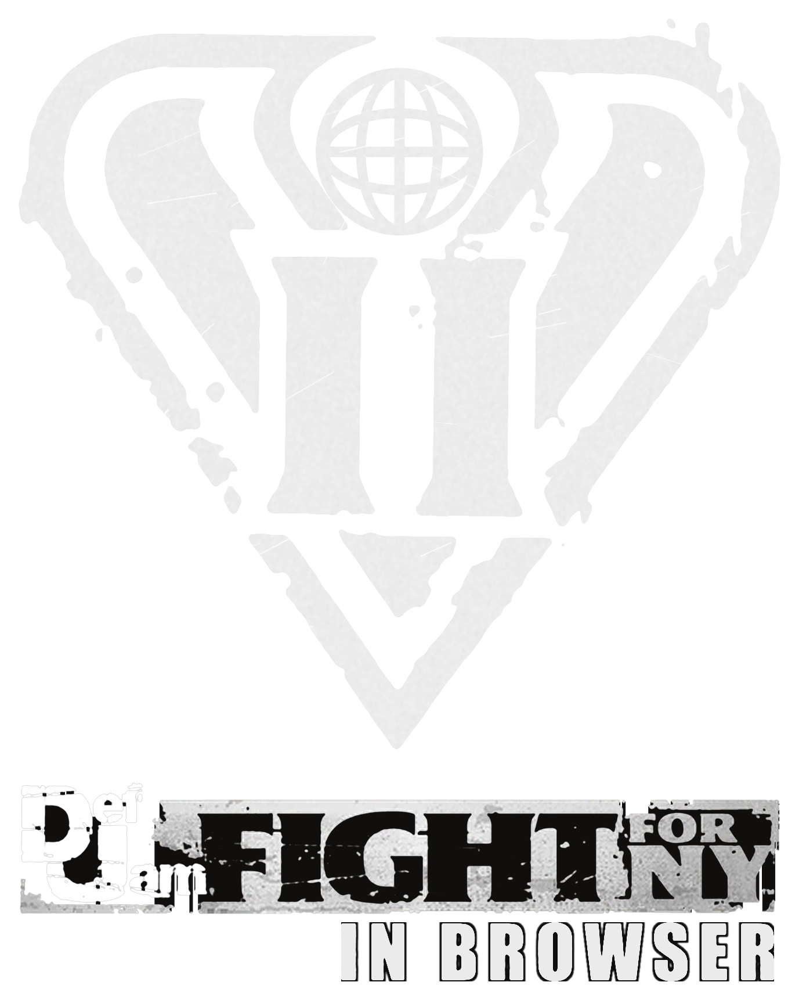
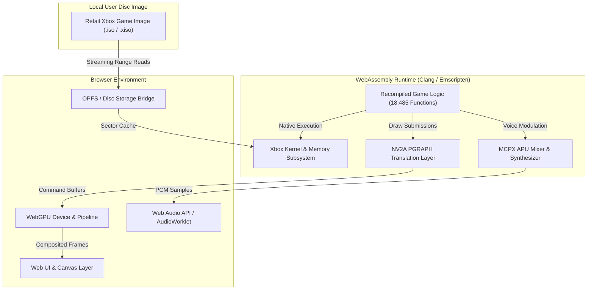

<div align="center">
  

  <br/><br/>

  [](https://webassembly.org/)
  [](https://www.w3.org/TR/webgpu/)
  [](https://caniuse.com/webgpu)
  [](LICENSE)
</div>

<br/>

A client-side browser port of **Def Jam: Fight for NY** (Original Xbox, 2004), statically recompiled from x86 machine code to WebAssembly, paired with a native WebGPU rendering backend and Web Audio system.

Executes client-side in modern web browsers via WebAssembly and WebGPU without server-side streaming or runtime CPU emulation.

---

## Architecture

Unlike traditional console emulators (which interpret or JIT-compile machine code at runtime inside a virtual machine), this project is built on **static ahead-of-time binary recompilation** using the [xboxrecomp](https://github.com/sp00nznet/xboxrecomp) toolchain.



### Key Engineering Highlights
- **Direct Native Execution**: The game's 18,485 x86 functions were statically lifted ahead-of-time to structured C source code, compiling into WebAssembly. Game logic, physics, and AI execute directly on host CPU cores at native speeds.
- **Hardware-Accelerated WebGPU**: Custom translation layer mapping Xbox NV2A programmable vertex shaders and fixed-function register combiners directly to modern WebGPU pipelines with cached geometry buffers.
- **Batched Coherent Publication**: Asynchronous semaphore fence management and batched GPU execution decouple the CPU game thread from GPU submission latencies.
- **Clean-Room Legal Compliance**: Contains **zero game assets, textures, code, or copyrighted files**. The user mounts their own legally owned retail game disc locally via the browser's File System Access API / OPFS.

---

## Status

| Subsystem | Status | Implementation Details |
|---|:---:|---|
| **Front-End & Menus** | **Full Speed (60 FPS)** | Title screen, autosave management, main menu, fight selection, character select, and arena selection. |
| **3D Rendering** | **Active** | Full NV2A primitive topology coverage, dynamic vertex shader execution via WebGPU, texture cache with Morton swizzle decoding. |
| **Combat Gameplay** | **Playable / In Optimization** | Complete fight simulation running. Currently undergoing performance optimization from ~13 FPS baseline toward sustained 60 FPS target. |
| **Audio** | **Operational** | BGM, voice lines, and sound effects decoded via MCPX APU voice generator and streamed via Web Audio API. |
| **Input** | **Operational** | Full XInput gamepad support (via Web Gamepad API) and keyboard mapping with deadzone and trigger threshold calibration. |
| **Saves & Storage** | **Operational** | Persistent save games and title caches stored in browser Origin Private File System (OPFS). |

---

## Controls

The port supports native USB/Bluetooth gamepads (Xbox, PlayStation, standard HID) via the browser Gamepad API, as well as keyboard mapping:

| Game Action | Xbox Controller | Keyboard Binding |
|---|---|---|
| **Navigate** | D-Pad / Left Stick | **Arrow Keys** / **W, A, S, D** |
| **Action / Select (A)** | Button **A** | **Space** |
| **Cancel / Back (B)** | Button **B** | **K** |
| **Punch (X)** | Button **X** | **J** |
| **Kick (Y)** | Button **Y** | **I** |
| **Start / Pause** | **Start** | **Enter** |
| **Block / Run** | **L / R Triggers** | **Left Shift / Q** |

---

## Building and Running

### Prerequisites
- [Node.js](https://nodejs.org/) (v18.0 or newer)
- [Python 3.10+](https://www.python.org/)
- Modern web browser with WebGPU support enabled (e.g. Google Chrome 113+, Microsoft Edge 113+, or Safari 18+).

### 1. Clone the Repository
```bash
git clone https://github.com/Deq710sia/ffny-browser.git
cd ffny-browser
```

### 2. Install Dependencies
```bash
npm install
```

### 3. Provide Disc Image
Place your legitimately dumped copy of **Def Jam: Fight for NY (USA)** in the project directory as:
```text
Def Jam - Fight for NY (USA).xiso.iso
```

### 4. Launch Local Development Server
```bash
npm start
```
The launcher will start a local server and open `http://127.0.0.1:8197` in your browser.

---

## Testing & Verification

Automated unit, ABI, and regression test suites can be executed with:

```bash
npm test
```

Automated headless browser integration benchmarks (testing route replay through menus to combat):

```bash
npm run test:benchmark
```

---

## Performance Optimization Roadmap

The project is currently working through a 4-phase optimization plan to bring combat to sustained 60 FPS on desktop and mobile devices:

- **Phase 0 (Completed)**: Asynchronous GPU semaphore fences, precomputed bit-exact APU gain lookup tables, and zero-delay worker yielding (jumped from 1.75 to ~13 FPS).
- **Phase 1 (In Progress)**: Single-pass WebGPU render-pass coalescing to eliminate mobile TBDR tile memory thrashing; C++ vertex attribute decode hoisting.
- **Phase 2**: Flat WebAssembly linear memory access (`i32.load`), Wasm JSPI (JavaScript Promise Integration) to eliminate Asyncify overhead, and Wasm SIMD128 for matrix transforms.
- **Phase 3**: High-level Web Audio AudioWorklet streaming (bypassing 64-channel software voice synthesis).
- **Phase 4**: Direct Criterion RenderWare / Direct3D8 API interception, bypassing low-level pushbuffer encoding entirely.

---

## Legal & Attribution

- **Def Jam: Fight for NY** is a trademark of Electronic Arts Inc. and Def Jam Recordings.
- This repository contains **no copyrighted code, binary executables, textures, audio, or game assets**.
- Users must provide their own legitimately acquired retail disc image to play.
- Built on foundational static recompilation research from the [xboxrecomp](https://github.com/sp00nznet/xboxrecomp) project by sp00nz and contributors. Third-party components retain their original licenses (see [THIRD_PARTY.txt](THIRD_PARTY.txt)).

---

## License

Licensed under the **MIT License**. See [LICENSE](LICENSE) for details.

